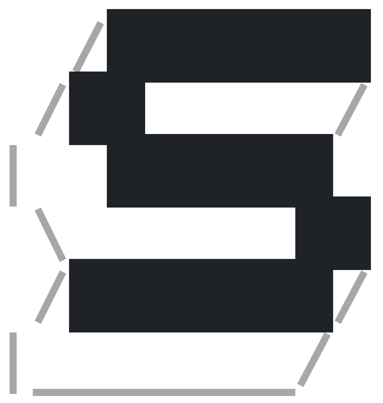

# Skelcrew

Skelcrew is Claude Code, but always on, in parallel, isolated, and seeing each task through to the merge.

You run `sc` in a checkout and talk to that repository's lead, an agent that writes tasks and starts threads. Each thread is a builder agent in its own branch, clone and sandbox. A fresh reviewer reviews its PR, and they go back and forth until it is ready. You merge.

## Install

```sh
curl -fsSL https://raw.githubusercontent.com/skelcrew/skelcrew/main/install.sh | sh
```

It runs on macOS and Linux, needs no sudo, and puts `sc` in `~/.local/bin`.

## First run

1. Run `sc` in a checkout of one of your repositories.
2. Say yes when it offers the GitHub plugin, `skelcrew/skel-plugin-github`. It connects GitHub and your harness.
3. Say yes to `sc init`. It writes a `skelcrew.yaml` that makes GitHub issues the repository's tasks, then opens the lead.
4. Commit and push `skelcrew.yaml`.
5. On GitHub, add the `skelcrew` label to an issue.

Within 2 minutes Skelcrew starts a thread on it, and the lead tells you. A reviewed PR follows.

## Keep working with the laptop closed

```sh
sc remote add sprite:<name>   # a Sprite
sc remote add <host>          # a server of your own
```

It sets the machine up and prints the command that connects to it, such as `sc --remote sprite:<name>`. Run that, and the work carries on after you close the laptop.

## Key commands

| Command | What it does |
| --- | --- |
| `sc` | Opens the lead of the repository you are in. |
| `sc init` | Writes a starter `skelcrew.yaml` in a checkout. |
| `sc ps` | Lists threads, with their status and which need you. |
| `sc attach <repo>-<task>` | Opens a thread's builder. Ctrl-Q detaches. |
| `sc stop <repo>-<task>` | Ends a thread and keeps its branch and PR. |
| `sc remote add <host>` | Sets up a server or Sprite to run Skelcrew. |
| `sc --remote <host>` | Connects to Skelcrew on that server. |

The full list is in [the spec](docs/spec.md#commands).

## How it works

Each task gets its own agent, in its own clone and sandbox, with no tokens inside. A fresh reviewer reviews each round, on another model if you choose one. Skelcrew acts on GitHub as `skelcrew[bot]`, never as you. The lead, builder and reviewer run on Claude Code or Codex, as `skelcrew.yaml` says.

## Status

Skelcrew is in beta. The full design is in [docs/spec.md](docs/spec.md).
