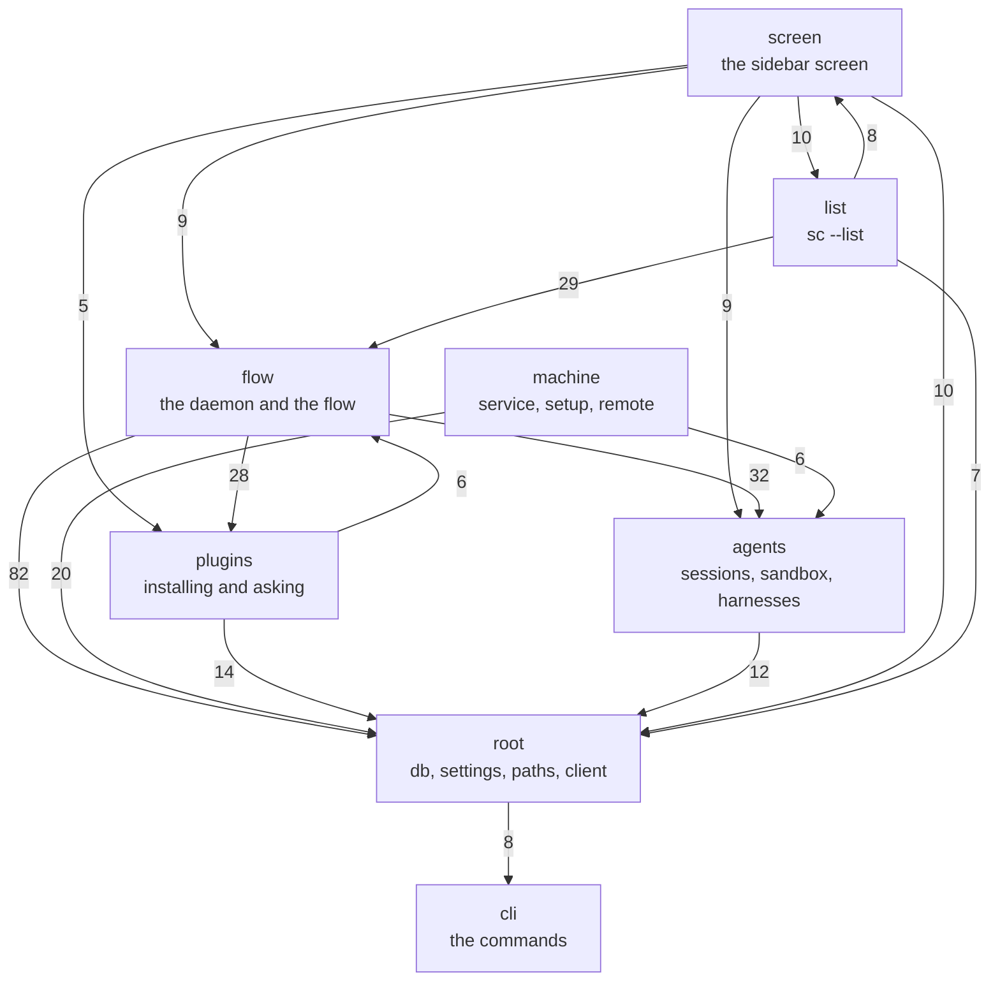

# Code map

Which folder of `src/` uses which. Read it to see where a change belongs, and what it might pull
along.

This page is counted from the `import` lines in `src/`, at the commit it was written on. It goes
stale as the code moves, so count again before leaning on a number. A count is how many import
lines go from one folder to another.

## The main lines

Only pairs with five imports or more are drawn. `root` is the files directly in `src/`, such as
`db.ts`, `settings.ts`, `paths.ts` and `client.ts`.

## What each folder is

| Folder | Files | What it is | Leans most on |
| --- | --- | --- | --- |
| `flow/` | 34 | The daemon and the flow: threads, rounds, polling, deciding, messages, merging | `root`, `agents`, `plugins` |
| `agents/` | 16 | The base modules that run agents, and one module per harness | `root` |
| `plugins/` | 7 | Installing plugins, reading manifests, asking trackers, forges and hosts | `root`, `flow` |
| `list/` | 8 | `sc --list`: rows, layout and the details pane | `flow`, `screen` |
| `screen/` | 9 | The sidebar screen: sidebar, top, footer, dropped files | `list`, `flow`, `agents` |
| `machine/` | 10 | This machine: the service, setup, updates and `--remote` | `root`, `agents` |
| `cli/` | 8 | One file per group of commands | `root`, `agents` |
| `root` | 17 | `main.ts`, the database, settings, paths, the client, roles and flows | `cli`, `flow` |

## Where folders use each other both ways

Most imports run one way: the screens use the flow, and the flow uses the base modules and the
plugins. These are the places where two folders import each other. The smaller side of each pair
is listed, file by file.

| From | To | Imports |
| --- | --- | --- |
| `flow/` | `screen/` | `flow/list.ts`, `flow/notify.ts` and `flow/own-items.ts` use `screen/look.ts`. `flow/repo.ts` uses `screen/drops.ts` |
| `list/` | `screen/` | Five files use `screen/look.ts`. `list/list.ts` uses `screen/footer.ts` and `screen/load.ts`. `list/rows.ts` uses `screen/progress.ts` |
| `plugins/` | `flow/` | `plugins/install.ts`, `plugins/install-files.ts` and `plugins/repository.ts` use `flow/repo.ts`. `plugins/ask.ts` uses `flow/copy.ts`. `plugins/install.ts` also uses `flow/thread.ts` and `flow/missing-plugins.ts` |
| `plugins/` | `screen/` | `plugins/install.ts` uses `screen/look.ts` |
| `plugins/` | `agents/` | `plugins/runtime.ts` uses `agents/sandbox.ts` |
| `machine/` | `screen/` | `machine/remote.ts` uses `screen/drops.ts` |
| `root` | `flow/` | `db.ts` uses `flow/decide.ts`. `client.ts` uses `flow/list.ts` and `flow/requests.ts`. `attach.ts` uses `flow/thread.ts` |
| `root` | `agents/` | `settings.ts` and `config.ts` use `agents/harness.ts`. `main.ts` uses `agents/sandbox.ts`. `attach.ts` uses `agents/sessions.ts` |

Two files account for much of it. `screen/look.ts` holds the colours and padding that everything
drawing text shares, so nine files outside `screen/` use it. `screen/drops.ts` is used by the
flow and by `--remote`.

## The biggest files

| File | Lines | What it is |
| --- | --- | --- |
| `src/flow/round.ts` | 1,581 | A round of the build and review loop |
| `src/flow/daemon.ts` | 1,479 | The daemon |
| `src/screen/sidebar.ts` | 1,242 | The screen's sidebar |
| `src/db.ts` | 1,145 | The database, and moving older ones forward |
| `src/flow/repo.ts` | 1,044 | The repositories Skelcrew works on |
