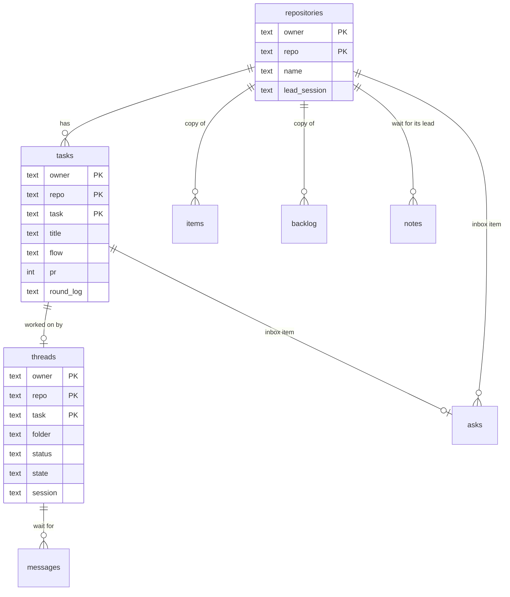

# Data model

Skelcrew keeps all its state in one SQLite file per machine, `~/.local/share/skelcrew/skelcrew.db`.
This page says what each table is for.

The tables are built in `src/db.ts`, which also moves an older database forward one column at a
time. So no single place in the code shows the whole schema. This page was drawn from a new, empty
database made by `openDb`. When it disagrees with the code, the code wins, and this page needs
fixing.

There are 19 tables and one view.

## The core

Tables join on `owner`, `repo` and `task`. A thread is also named by its `folder`, which names its
clone, session, socket and log, and which `messages` and `notified` use.

**Read threads through `task_threads`.** It is a view that joins each thread to its task, and it
is what the code reads into a `Thread`. The `threads` table still has columns of its own for what
now lives on `tasks`, from before tasks had a table. The view takes those from `tasks`.

## Every table

| Table | Columns | One row per | What it holds |
| --- | --- | --- | --- |
| `repositories` | 28 | Repository | Its name, forge and remote, its lead's session, host and state, and what its lead has been told |
| `tasks` | 51 | Task | Title, body, flow, the lead's updates, decisions and what must stay true, its issue and PR, CI, the round and review state, the round's record, and the last ID handled per kind of event |
| `threads` | 96 | Thread | Its folder, branch, status, agent state, session and host, why it needs you, and its armed merge |
| `items` | 7 | Issue or PR | Skelcrew's copy of each tracker's open issues and each forge's open PRs, as JSON |
| `pr_agents` | 6 | Open PR | Whether its changes touch `.agents/`, so a merge confirm can say so |
| `backlog` | 8 | Backlog task | The daemon's copy of the tasks filed with `sc add`, which the remote keeps |
| `filing_tries` | 6 | Try to file | A filing whose outcome this machine has not heard yet, so it is filed once |
| `backlog_starts` | 4 | Claimed start | A backlog task this machine claimed and has no thread for yet |
| `claims` | 3 | Claim asked for | A claim on a labelled issue whose outcome is not known yet |
| `asks` | 7 | Inbox item | The lead's open item on a task or a repository, with its title and options |
| `messages` | 9 | Message | What waits to be typed into a builder, and whether it sits unsent at its prompt |
| `notes` | 7 | Note | What waits to be typed into a lead |
| `notifications` | 7 | Message to you | What waits to go out through a notifier |
| `notified` | 2 | Thread | The mark a needs-you message was last sent for |
| `limits` | 5 | Harness | A usage limit holding reviews: until when, and which leads were told |
| `plugins` | 5 | Installed plugin | The folder it runs from and its source |
| `removed_plugins` | 1 | Source | The sources of plugins you removed |
| `installed` | 1 | At most one | The release installed in the background, until the daemon runs on it |
| `upgrades` | 1 | Step | Work on an older database left for the daemon to finish |

## What is not in the database

- **The queue of check slots.** It is kept only in the daemon's memory.
- **Each task's log.** Every change is also appended to
  `~/.local/share/skelcrew/threads/<repo>-<task>.log`, one JSON line each.
- **The backlog itself.** The remote keeps it. The `backlog` table is a copy.
- **What you approved.** The `.agents/` you approved for each repository is in
  `~/.config/skelcrew/`.

## Things to know before changing it

- **A change must work on an older database.** New columns are added with `ALTER TABLE`, and a
  copy of the file is saved before a move.
- **An older daemon may still be running.** Some tables and columns stay only because a daemon of
  an earlier release can still read or write them until it restarts.
- **Everything read back is checked.** A row from disk goes through Zod before the code uses it.
