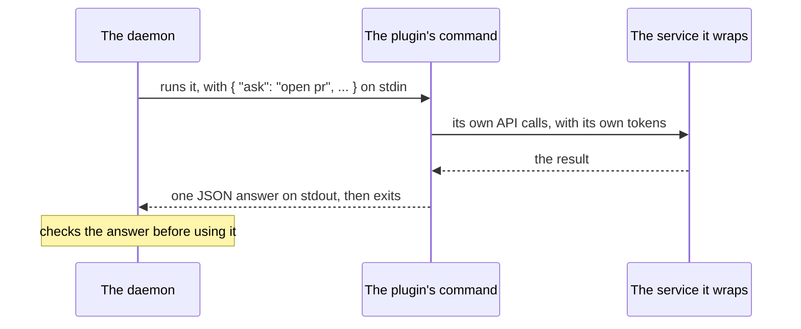

# Plugin contract

What a plugin must do, on one page, for someone writing one. It is a short form of **Plugins** in
`docs/spec.md`, which holds the full rules and wins where they differ. The manifest is checked by
`Manifest` in `src/plugins/plugin.ts`.

## The shape

A plugin is a git repository with a `skelcrew-plugin.yaml` at its root. Skelcrew talks to it by
running one of its commands, with one JSON question on stdin and one JSON answer on stdout.

- **Commands are lists of words**, run in the plugin's folder, never through a shell.
- **A command whose first word is `bun`** runs on the Bun inside Skelcrew.
- **An answer has 60 seconds.**
- **On an error**, the last line of stderr is the error. Exit code 2 means the plugin needs its
  setup again.
- **A plugin runs as you, outside the sandbox.** Agents never see its folder or its tokens.

## The manifest

| Key | Needed | What it is |
| --- | --- | --- |
| `name` | Yes | Lowercase letters, digits and dashes. Not `none` |
| `version` | Yes | The same as the tag it is installed from |
| `skelcrew` | Yes | The oldest Skelcrew release it works with |
| `about` | Yes | One line in plain words, shown first when Skelcrew asks to install it |
| `kind` | Yes | `io` or `runtime` |
| `provides` | Yes | What it provides, within its kind |
| `build` | No | Commands run once, at install |
| `setup` | No | Runs in your terminal, and asks for what the plugin needs, such as a sign-in |
| `call` | For `tracker`, `forge`, `notifier` | Answers Skelcrew's questions |
| `git_credentials` | For `forge` | A git credential helper, handed to git for each command and never saved |
| `session` | For `sessions`, `transport`, `status`, `files` | The session functions |
| `attach` | For `sessions` | Attaches your terminal to a session |
| `add`, `exec`, `push` | For `machine` | Reaching a machine that runs Skelcrew |
| `channel` | No | How a notifier reaches you, such as `email` or `push` |

Every command gets `SKELCREW_PLUGIN`, its name, and `SKELCREW_PLUGIN_CONFIG`, a folder only you
can read, for its settings and tokens. `setup` also gets `SKELCREW_REMOTE` when `sc` ran in a
checkout.

## What a plugin can provide

| Kind | Provides | What it is for |
| --- | --- | --- |
| I/O | `tracker` | Issues in, and closing them |
| I/O | `forge` | PRs, reviews, checks and merges |
| I/O | `notifier` | Messages to you while you are away |
| I/O | `chat` | Not built yet |
| Runtime | `sessions` | Runs agents' sessions in place of tmux |
| Runtime | `transport` | Gets text into an agent once it is idle |
| Runtime | `status` | Shows each agent's status on the host |
| Runtime | `files` | Lets an agent read files you drop on its session |
| Runtime | `machine` | Reaches a machine, for `sc --remote <plugin>:<name>` |

No plugin can provide messages or the sandbox. Who may reach whom, and what an agent can touch,
are Skelcrew's on every setup. A harness is never a plugin.

## The questions on `call`

| `ask` | Asked of | In short |
| --- | --- | --- |
| `claims` | Forge | Is this remote yours? Answers the repository, or `null` |
| `changed` | Tracker, forge | What changed since the last `next`. Answers `items` and the new `next` |
| `create task` | Tracker | Files an issue |
| `took` | Tracker | Claims an issue before it starts, so one machine starts it |
| `assign` | Tracker | Assigns the issue to you, or takes you off |
| `close task` | Tracker | Closes an issue, with a comment or none |
| `open pr` | Forge | Opens a PR, or answers the one already open from that branch |
| `edit pr` | Forge | Replaces the PR's description |
| `merge pr` | Forge | Merges, only while the head is still the commit you saw approved |
| `close pr` | Forge | Closes the PR and deletes the branch |
| `review` | Forge | Posts a review, body unchanged, and answers its ID |
| `edit review` | Forge | Changes a review Skelcrew posted |
| `status` | Forge | Sets a commit status, such as `skelcrew/check` |
| `seen` | Forge | Marks a comment or review as seen |
| `log` | Forge | What failed in a check |
| `notify` | Notifier | Delivers one message: `needs-you`, `digest` or `asked` |

An older plugin may answer `null` to a question it does not know. The spec says what Skelcrew does
then, question by question.

## The questions on `session`

A runtime plugin that provides `sessions` answers these on its `session` command. `attach` is a
command of its own, as it runs in your terminal.

| `ask` | In short |
| --- | --- |
| `start` | Starts a session running the command Skelcrew gives, exactly as given. Answers its ID |
| `paste`, `keys` | Puts text or keys into the session |
| `read` | What the session shows now, and whether someone scrolled back |
| `interrupt` | Stops the agent's turn, as Esc does |
| `end` | Ends the session, and waits until every process in it has exited |
| `list` | The host's sessions, with Skelcrew's labels |
| `rename` | Names the session by its thread's title. A host may say it does not know this one |
| `deliver`, `idle` | With `transport`: types a message once the agent is idle, and says when it is |
| `status` | With `status`: shows `working`, `idle`, `needs you`, `ready` or `error` on the host |

**The one rule a host must keep:** it runs the sandboxed command exactly as Skelcrew gives it. A
host that provides `files` may swap one placeholder path for the session's folder of dropped
files, and nothing else.

## Where a plugin lives

| Kind of plugin | Named in | Pinned in |
| --- | --- | --- |
| The repository's, such as its tracker and forge | `plugins:` in `skelcrew.yaml` | `skelcrew.lock`, which you commit |
| Yours: every runtime plugin and every notifier | Nowhere in a repository | `~/.config/skelcrew/skelcrew.lock` |

Skelcrew never installs a plugin silently. `sc install` installs what the files pin, and `sc
plugin add` and `sc plugin update` ask first.
