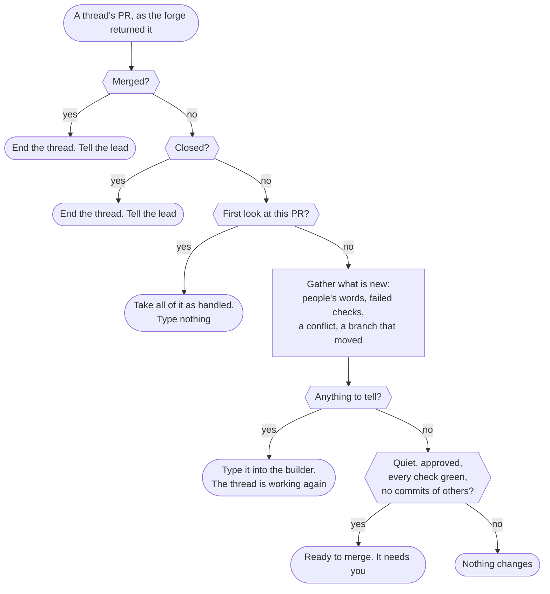

# What a PR event does

Every poll, the daemon asks each repository's forge what changed, and decides what each thread's PR
means for it. The deciding is pure: given a thread and its PR, it returns what to do. It reads no
clock, files or network.

This page is a view of `decide` in `src/flow/decide.ts`. When they disagree, the code wins, and
this page needs fixing. `test/decide.test.ts` pins each case down.

## In order

`decide` checks these in order. The first two end there. The rest add up.

## What counts as new

Each event is handled once. The task keeps the IDs of the reviews, comments and check runs it has
acted on, and only those it has not seen count.

| On the PR | Typed into the builder when | Notes |
| --- | --- | --- |
| A review or comment by **you** | Always, even past the round limit | The forge then marks it seen, such as with 👀 |
| A review or comment by **someone who can push** | Only within the round limit | The same |
| A review or comment by **anyone else, or a bot** | Never | On a public repository anyone can comment, and what is typed in steers the builder |
| **Failed checks** | Once every check has finished, and no round is being pushed | Told together, with each one's log from the forge |
| **A conflict** with the base branch | Only while the thread is quiet | Told with how to fix it |
| **The branch moved** on the forge, without the builder | Once for each commit it moved to | Told even while a round is submitting |

**Quiet** means the thread is `waiting`, with no submit and no review under way.

## What follows

- **Anything typed in sets the thread `working`.** Past the round limit it still needs you, as
  the builder's next round would.
- **A conflict takes an approved task out of `ready for review` at once**, before the builder
  hears of it. It stays out until a new round is approved.
- **Ready needs all of it.** The thread is quiet, does not already need you, its branch holds
  only commits Skelcrew pushed, its review approved, and every check is green.
- **Skelcrew's own review is not an event here.** It comes from the round, in
  `src/flow/round.ts`, and its check, `skelcrew/check`, is left out of CI.

## Without a PR

A thread in a repository with no forge, or whose PR did not open, has only its branch.
`decideBranch` tells its builder once for each commit that someone else pushed there, and the
thread stops being ready to merge. Nothing else happens without a forge but the reviews and the
end of the branch.

## Starting from a label

`labeledToStart` picks the labelled issues that get a thread: those no task has. A thread that
failed, was stopped or is done keeps its row, so its label never starts it again. Only `sc start`
does.
