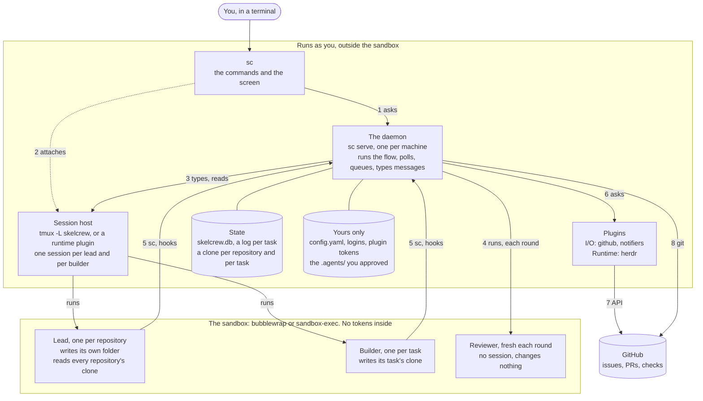

# System map

What runs where, and who talks to whom. Read this before the spec, to know where a detail belongs.

This page is a view of `docs/spec.md` and the code. When they disagree with it, they win, and this
page needs fixing. It is drawn from `src/paths.ts`, `src/flow/daemon.ts`, `src/flow/requests.ts`,
`src/agents/sandbox.ts`, `src/agents/sessions.ts` and `src/plugins/plugin.ts`.

| Arrow | What goes over it |
| --- | --- |
| 1 | Every `sc` command asks the daemon, on `skelcrew.sock` |
| 2 | The screen attaches your terminal to a session |
| 3 | The daemon starts sessions, pastes messages, sends keys and reads the screen |
| 4 | The daemon runs a fresh reviewer for each round and reads its answer |
| 5 | Agents run `sc` commands, such as `sc submit` and `sc tell`, and their hooks report state. Each agent has a socket of its own. A reviewer may only run `sc check` |
| 6 | The daemon asks a plugin with `call`, and gets a forge's login for git with `git_credentials` |
| 7 | The GitHub plugin polls, opens PRs, sets checks and merges |
| 8 | The daemon fetches and pushes, from its own clone, never from a task's |

## What the map says

- **One daemon does everything outside the sandbox.** It alone pushes, calls plugins and writes
  the database. Agents only run `sc` commands.
- **Each agent has a socket of its own.** That is how the daemon knows who is calling, and it
  refuses any request that caller may not make. `src/flow/requests.ts` holds the list.
- **Sessions outlive the daemon.** The session host keeps agents running through a restart or an
  update. The daemon finds them again by their labels.
- **The reviewer is not a session.** The daemon runs it once per round and reads its answer. It
  sees the task's clone through a throwaway layer.
- **Plugins run as you.** They hold the tokens, in your home folder, which the sandbox hides.
- **A remote changes nothing here.** `sc --remote <host>` runs `sc` on that machine over `ssh -t`.

## Where things live on disk

| Place | What it holds |
| --- | --- |
| `~/.local/share/skelcrew/skelcrew.db` | All state: repositories, tasks, threads, messages, the inbox, the queues |
| `~/.local/share/skelcrew/threads/<repo>-<task>.log` | Every change to a task, one JSON line each |
| `~/.local/share/skelcrew/repos/<owner>/<repo>/` | Skelcrew's clone of each repository. Pushes leave from here |
| `~/.local/share/skelcrew/threads/<repo>-<task>/` | A task's clone, which its builder writes |
| `~/.local/share/skelcrew/leads/<owner>/<repo>/` | A lead's own folder |
| `~/.config/skelcrew/` | Yours only: `config.yaml`, your lock, logins, plugin settings and tokens |
| `$XDG_RUNTIME_DIR/skelcrew.sock` | The socket `sc` asks the daemon on |
| `$XDG_RUNTIME_DIR/skelcrew/{leads,threads,reviews}/<hash>/skelcrew.sock` | One socket per agent, mounted into its sandbox |

## Where the code is

| Folder | What it is |
| --- | --- |
| `src/flow/` | The daemon and the flow: threads, rounds, polling, deciding, messages, merging |
| `src/agents/` | The base modules that run agents: sessions, transport, sandbox, and one module per harness |
| `src/plugins/` | Installing plugins and asking them |
| `src/screen/`, `src/list/` | What you see: the screen, and the list of tasks it shows |
| `src/cli/` | One file per group of commands, each asking the daemon through `src/client.ts` |
| `src/machine/` | This machine: the service, setup, updates and `--remote` |
| `src/db.ts` | The one SQLite file |
