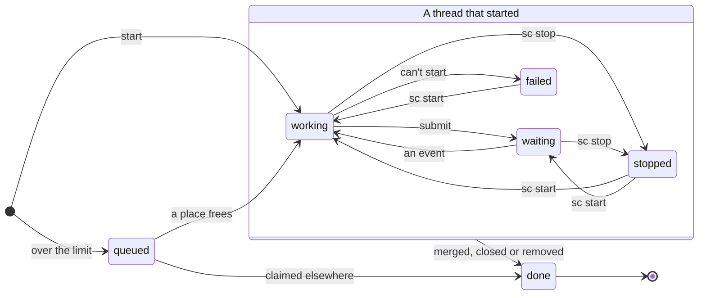
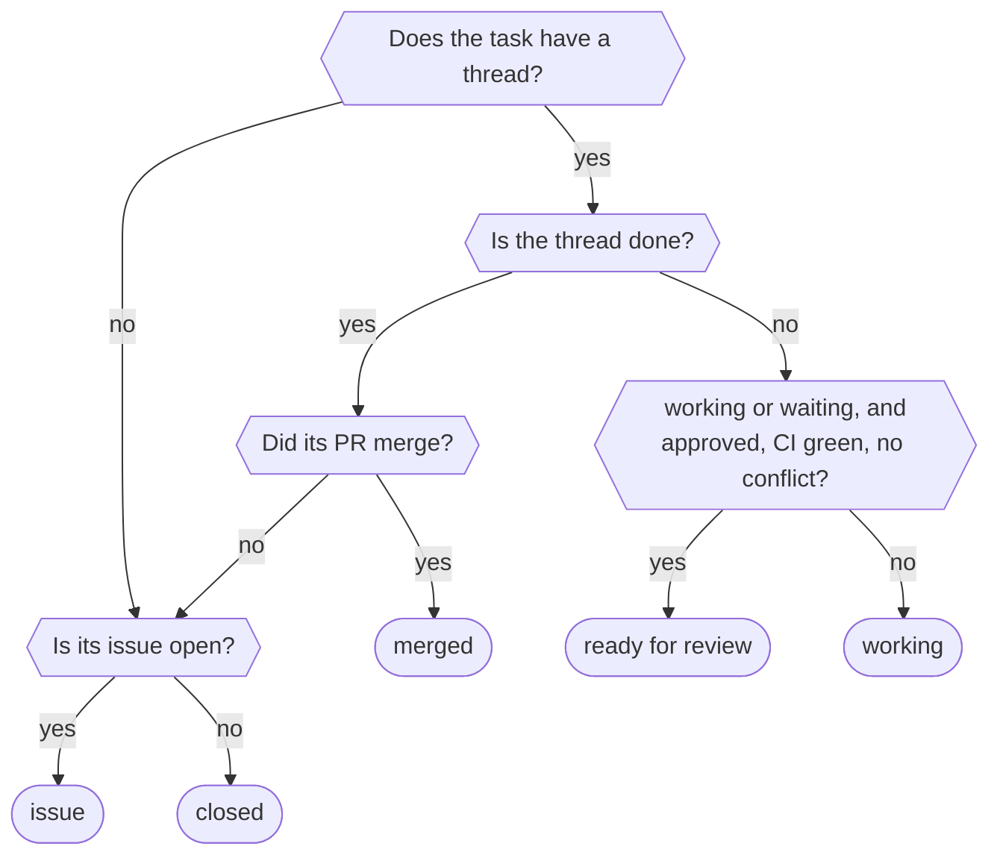

# Task lifecycle

How a task moves from an issue to a merge, and which of Skelcrew's words describe it at each point.

Four sets of words describe the same task. They are easy to mix up, so this page puts them side by
side. Only two of them are saved. The other two are worked out each time they are shown.

| Words | Values | Saved? | Where |
| --- | --- | --- | --- |
| **Thread status**: what the work is doing | `queued`, `working`, `waiting`, `failed`, `stopped`, `done` | Yes, on the thread | `src/flow/thread.ts` |
| **Agent state**: what the builder's session is doing | `working`, `idle`, `asking`, `error` | Yes, from hooks | `src/flow/status.ts` |
| **Task stage**: where the task is | `issue`, `working`, `ready for review`, `merged`, `closed` | No, worked out | `src/flow/stage.ts` |
| **List stage**: which section shows it | Backlog, Building, Reviewing, Checks, Ready, Done | No, worked out | `src/flow/stage.ts` |

This page is a view of `docs/spec.md` and the code. When they disagree with it, they win, and this
page needs fixing.

## Thread status

The one thing that is saved and moves. Everything else on this page follows from it.

| Arrow | What happens |
| --- | --- |
| start | `sc start`, or the `skelcrew` label on an issue |
| over the limit | The repository already runs `limits.threads` builders |
| a place frees | One of the repository's builders ends, first come first served |
| claimed elsewhere | Another machine claimed the issue while it waited |
| submit | The builder runs `sc submit` |
| an event | Skelcrew tells the builder something: a review asks for changes, a check fails, a person comments, a merge conflict, or `sc start` past the round limit |
| sc stop | Ends the builder and keeps its clone, branch and PR |
| sc start | Brings the builder back. It waits when a round is already submitted, and works otherwise |
| can't start | Its clone or its builder could not be set up |
| merged, closed or removed | Its PR merged or closed, or `sc rm` |

A working thread also goes back to waiting with no submit, when its builder only replied to a
comment on an approved PR.

`waiting` covers three waits: on the review, on CI, and on you. The round's record in
`src/flow/ledger.ts` says which.

## Needs you is a flag, not a status

A thread that needs you stays where its work is. Its row says why, in one word. The word is the
first of these that holds, from `threadWord` in `src/flow/status.ts`:

| Word | Why |
| --- | --- |
| A mark, such as `run sc install` | The lead, or Skelcrew, marked what you must do |
| `question` | The builder asked with its question tool, or sits at a startup question |
| `error` | Its harness stopped on an error that is not a usage limit |
| `round limit` | A review asked for changes after the flow's `rounds` |
| `approved` or `not reviewed` | Approved, CI green, no conflict: yours to merge |
| `turn ended` | The builder stopped without submitting |

## From status to stage

A task's stage is worked out from its builder thread and whether its issue is still open. This is
`taskStage` in `src/flow/stage.ts`.

So a thread that stopped or failed keeps its task in `working`. It does not vanish, and it is never
`ready for review`, even after an approval, until `sc start` brings it back.

## Where the list shows it

The list splits `working` into the sections you see. This is `listStage` in the same file.

| List stage | When |
| --- | --- |
| Backlog | Stage `issue`: not started, or ended without merging while its issue is open |
| Building | A builder at work. Also a thread that stopped or failed, as its builder must start again |
| Reviewing | A submit or review under way, held on a usage limit, or one that could not run |
| Checks | Approved, or submitted in a flow with no review, and waiting on CI |
| Ready | Stage `ready for review`, with or without a merge armed |
| Done | Stage `merged` or `closed` |

The task queue is not a stage. It is shown between Backlog and Building, and holds threads whose
status is `queued`.

## The builder's own state

Separate from all of the above: what the session is doing right now. It comes from the harness's
hooks, with a screen check every two seconds for the two cases no hook covers.

| State | Set when |
| --- | --- |
| `working` | A message goes in, or a question is answered |
| `idle` | A turn ends, or you press Esc |
| `asking` | The builder uses its question tool, or a startup question shows on screen |
| `error` | A turn ends on an error |

A thread can be `working` while its builder is `idle`, such as after Esc. The status says what the
work is waiting for. The state says whether anything is running.
