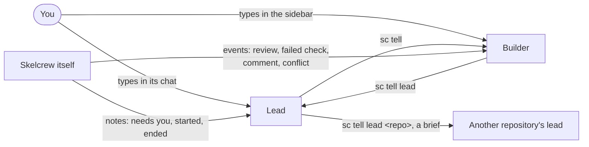

# Who may ask what

Every `sc` command becomes a request to the daemon. The daemon knows who is asking by the socket
the request comes in on, and refuses any request that caller may not make, before acting.

This page is a view of `allowed` in `src/flow/requests.ts`. When they disagree, the code wins, and
this page needs fixing. The table has all 43 requests.

## The four callers

| Caller | Its socket | What it is |
| --- | --- | --- |
| You | `skelcrew.sock` | `sc` in your own terminal |
| Lead | One per repository | A repository's lead, in its sandbox |
| Builder | One per thread | A thread's builder, in its sandbox |
| Reviewer | One per thread | A round's reviewer, in its sandbox |

## The table

| Request | You | Lead | Builder | Reviewer |
| --- | :-: | :-: | :-: | :-: |
| **Looking** | | | | |
| `status` | yes | yes | yes |  |
| `repo ls` | yes | yes |  |  |
| `repo named` | yes | yes |  |  |
| `ps` | yes | yes |  |  |
| `task ls` | yes | yes |  |  |
| `task show` | yes | yes |  |  |
| `peek` | yes | yes |  |  |
| **Leads and repositories** | | | | |
| `lead` | yes |  |  |  |
| `end lead` | yes |  |  |  |
| `rename builders` | yes |  |  |  |
| `restart` | yes |  |  |  |
| **Tasks and threads** | | | | |
| `task create` | yes | yes |  |  |
| `task add` | yes | yes |  |  |
| `start` | yes | yes |  |  |
| `start new` | yes | yes |  |  |
| `stop` | yes | yes |  |  |
| `queue move` | yes |  |  |  |
| `interrupt` | yes | yes |  |  |
| `rm preview` | yes | yes |  |  |
| `rm` | yes | yes |  |  |
| `review` | yes | yes | yes |  |
| **Merging** | | | | |
| `merge` | yes |  |  |  |
| `merge preview` | yes |  |  |  |
| `merge when ready` | yes | yes |  |  |
| `merge skip review` | yes | yes |  |  |
| `merge cancel` | yes | yes |  |  |
| **The inbox** | | | | |
| `ask` |  | yes |  |  |
| `answer` | yes |  |  |  |
| `pick` | yes |  |  |  |
| **Talking** | | | | |
| `tell` |  | yes |  |  |
| `tell lead` |  |  | yes |  |
| `brief lead` |  | yes |  |  |
| `notify` |  | yes |  |  |
| **What a review goes by** | | | | |
| `decide` |  | yes |  |  |
| `keep true` |  | yes |  |  |
| **A builder's round** | | | | |
| `submit` |  |  | yes |  |
| `check` | yes |  | yes | yes |
| **Hooks, reporting an agent's state** | | | | |
| `question asked` |  | yes | yes |  |
| `question answered` |  | yes | yes |  |
| `question closed` |  | yes | yes |  |
| `turn ended` |  | yes | yes |  |
| `turn failed` |  | yes | yes |  |
| `turn interrupted` |  | yes | yes |  |

## The rules behind it

- **Merging is yours alone.** No agent may send `merge`. A lead may arm a merge, when ready or
  skipping the review, only while your config lets it. The daemon checks that at each one. A lead
  may always cancel one, as that is safe.
- **Only the lead posts to the inbox, and only you answer.** A builder brings what it needs to
  the lead.
- **A builder reaches only its own repository's lead.** It can't tell another thread. It may ask
  for a review of its own thread only.
- **You have no `tell`.** You type to a builder yourself, in the sidebar.
- **Only a lead records what a review goes by**, with `decide` and `keep true`. A builder must
  never change what it is reviewed against.
- **Only a lead briefs another repository's lead.** Each lead plans its own repository's work.
- **A reviewer may only run `check`.** It sends nothing to anyone.
- **Which queued task starts next is yours**, and so is restarting an agent.
- **Trusting a repository is never a request.** Only you can, in your own terminal.

## Who may tell whom

Messages typed into an agent follow the same shape. They are in `src/flow/messages.ts`.

Every message from an agent goes in wrapped in a `<skelcrew>` tag that says who it is from and the
command to answer with. A brief from another lead is a report. That lead starts nothing on it
until you say yes, unless it carries your own words.
